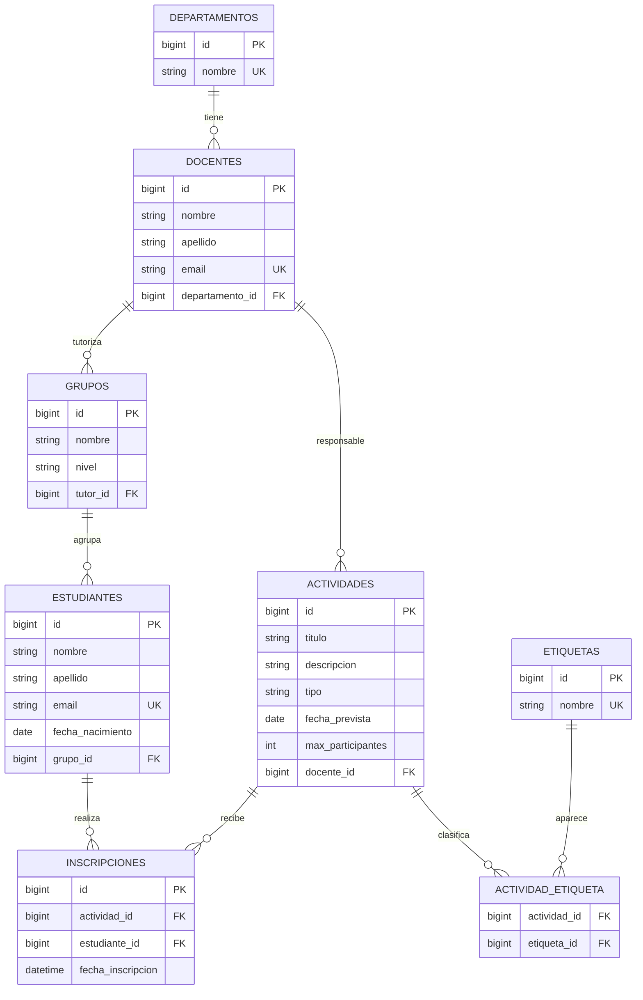

# CampusHub — Modelo relacional

El modelo relacional se almacena en PostgreSQL. Los seguimientos y contactos se almacenan en MongoDB.

## Relaciones y restricciones

- Cada docente pertenece a un departamento; cada estudiante pertenece a un grupo.
- Cada actividad tiene un docente responsable y admite múltiples inscripciones.
- La pareja `(actividad_id, estudiante_id)` es única en `inscripciones`.
- Las etiquetas tienen una relación muchos a muchos con las actividades.
- Los correos de estudiantes y docentes y los nombres de departamentos y etiquetas son únicos.
- Los identificadores relacionados se protegen mediante claves foráneas.

## Índices

Las claves primarias y las restricciones UNIQUE generan índices en PostgreSQL. Conviene añadir índices sobre las claves foráneas consultadas frecuentemente: `inscripciones(actividad_id)`, `inscripciones(estudiante_id)`, `actividades(docente_id)` y la tabla intermedia `actividad_etiqueta(etiqueta_id)`.

## Comportamiento de borrado

Se recomienda impedir el borrado de estudiantes, actividades o docentes que tengan datos relacionados, salvo que exista una operación de borrado diseñada expresamente para resolver esas dependencias. La API inicial no incluye operaciones DELETE.

> El diagrama refleja las clases del ZIP anterior. Verificar los nombres físicos de columnas y restricciones en PostgreSQL antes de aplicar scripts SQL.
